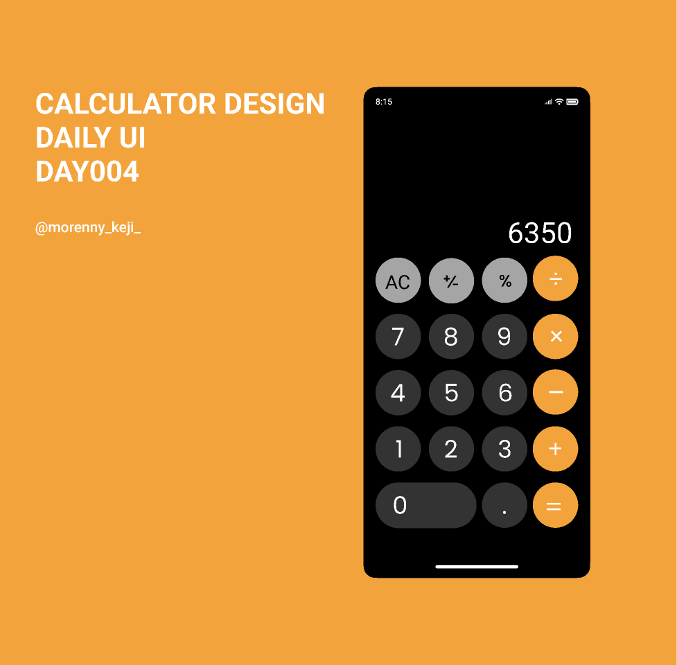
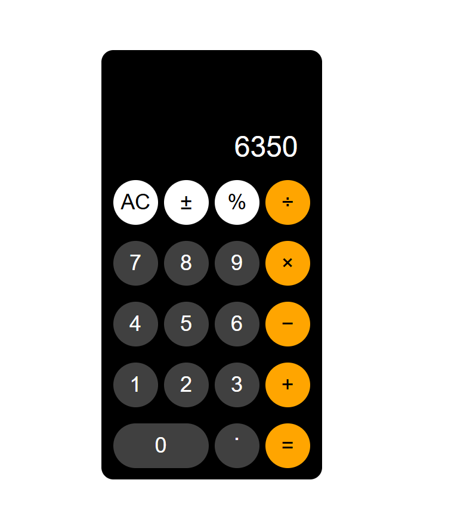

# Grid display
on this repo i learn how to use grid display on css, to exercise
i made the calculator design based on reference image

### Reference

## Update
i have update the html to be interactive and can calculate like real calculator
i use js `eval` global function to evaluated the experssion that made from input with 
joining arrays

### New Result

## Old result

### Result
